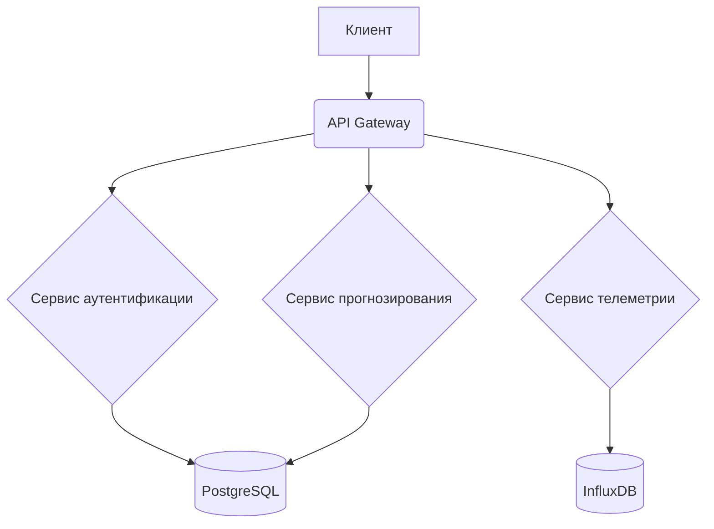

# Проект ИС ПТО для АО "СибКа"

Информационная система предиктивного технического обслуживания карьерной техники.

## Ключевые особенности

*   **Сбор телеметрии** — данные с датчиков температуры, вибрации и давления.
*   **Предиктивная аналитика** — прогнозирование отказов на основе машинного обучения.
*   **Интеграция** — взаимодействие с ERP (1С:УПП) и СЭД.
*   **Веб-интерфейс** — дашборды для инженеров, механиков и руководства.

## Структура данных



## Команда проекта

*   Инженер-программист
*   Системный аналитик

## Технологии

*   Python 3.11+
*   Git, GitHub Actions
*   MySQL / PostgreSQL

## Примечание

Wiki в GitHub доступен только для публичных репозиториев на бесплатном тарифе. Документация размещена в README.md.

## Реализованный модуль контроля состояния

`telemetry.py` принимает и проверяет показания, `diagnostics.py` определяет
пороговый статус, `main.py` запускает обработку и выводит JSON.
Подключение к реальным датчикам, машинное обучение, БД и интеграция с 1С
пока относятся к планируемой архитектуре, описанной выше.
Без входного файла используется встроенный программно сформированный набор
показаний; программа не выдаёт его за измерения с машины.

### Формат входа

JSON-объект содержит ровно три числовых поля:
`temperature` (°C), `vibration` (мм/с), `pressure` (бар).
Вибрация и давление неотрицательны. Нулевые показания сохраняются.
Строки, bool, пропуски, неизвестные поля, NaN и бесконечности отклоняются.

Начальный профиль верхних порогов:

| Параметр | Предупреждение от | Критический статус от |
| --- | ---: | ---: |
| Температура | 90 °C | 105 °C |
| Вибрация | 4,5 мм/с | 7,1 мм/с |
| Давление | 16 бар | 20 бар |

Равенство включает порог. Критический статус имеет приоритет; все причины
сохраняются в `alerts`. Для другого узла профиль передаётся через
`assess_condition(readings, thresholds=...)`. Эти значения — настройки
приложения, а не нормативы производителя. Контроль нижнего давления и
прогноз остаточного ресурса этим модулем не реализованы.

### Запуск

```bash
python main.py
python main.py --input readings.json
```

Успешная обработка, в том числе предупреждение или критический статус,
возвращает код 0. Ошибка файла или телеметрии — код 2, сообщение в stderr,
без диагностического JSON в stdout.

### Автоматические проверки

```bash
python -m pip install -r requirements-dev.txt
python -m pytest -v --cov=telemetry --cov=diagnostics --cov=main --cov-branch
```

В GitHub: **Actions → Python Tests → запуск → Tests / Python ...**.
Доступен ручной запуск **Run workflow** с выбором ветки.
Матрица запускает один набор тестов на Python 3.11, 3.12 и 3.13.
Отчёты JUnit, XML и HTML покрытия сохраняются в **Artifacts** отдельно для
каждой версии Python. Порог покрытия строк и ветвей — 90 %.

Сценарии и критерии описаны в [docs/testing.md](docs/testing.md).
